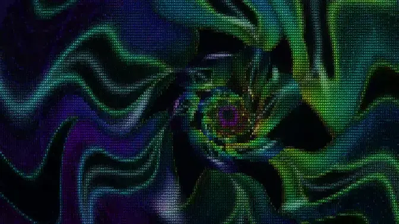
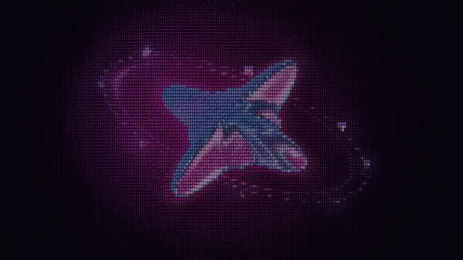
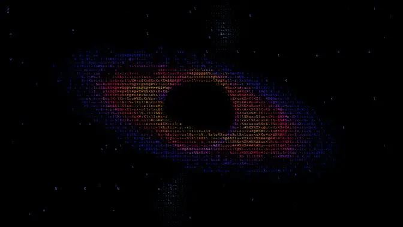
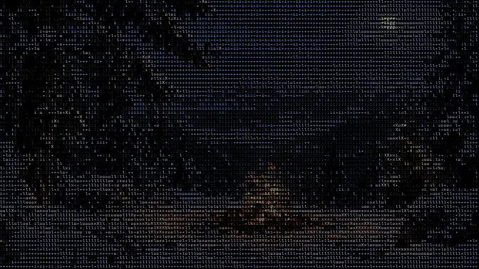

<div align="center">

# AnimatedASCII

**Fourteen live wallpapers for Windows, drawn in ASCII.**



</div>

| Kinetic | What moves |
| :--- | :--- |
| **Kaleido Drive** | Mirrored facets twist and send waves of color down a tunnel. |
| **Bloom Breaker** | Thousands of particles form a flower, scatter, braid together, and rebuild. |
| **Ink Fold** | A black-and-white ribbon folds over itself as ink patterns travel across it. |

<details>
<summary>Y2K collection</summary>



| Y2K | What moves |
| :--- | :--- |
| **Chrome Bloom** | A liquid chrome star tumbles through an orbit of pearls and pink glints. |
| **Dial-Up Dream** | A translucent aqua terminal floats through rising bubbles while its waveform and LEDs react. |
| **Chrome Cross** | A silver pendant spins, breaks into orbiting pieces, and snaps back together. |
| **Heart Circuit** | Glowing pink hearts stretch and pulse through a liquid pattern. |
| **Silver Stars** | Chrome stars glide through rolling RGB glitches and settle back into formation. |

</details>

<details>
<summary>Neon abstract collection</summary>



| Neon abstract | What moves |
| :--- | :--- |
| **Event Horizon** | Gold and ultraviolet light curl around a dark core, with bursts of particles at the poles. |
| **Prism Engine** | Cyan, violet, and lime rings tumble in 3D around a pulsing crystal. |
| **Liquid Signal** | Teal and hot pink ribbons fold, cross, and shimmer. |

</details>

<details>
<summary>Christmas collection</summary>



| Christmas | What moves |
| :--- | :--- |
| **Fireside Forest** | Amber flames flicker and embers rise through moonlit snow. |
| **Christmas Eve** | Chimney smoke drifts above a cabin while warm reflections ripple in the creek. |
| **Northern Lights** | An emerald aurora moves over a lit Christmas tree as a shooting star passes. |

</details>

## Run on Windows

Install [Node.js 20 or newer](https://nodejs.org/), then run these commands in the project folder.

```sh
npm install
npm start
```

Choose a scene and click **Set as wallpaper**. Keep the app open to animate your primary monitor. Use **Full screen** to watch the scene on its own.

Run `npm run build` on Windows to create an installer in `dist/`.
